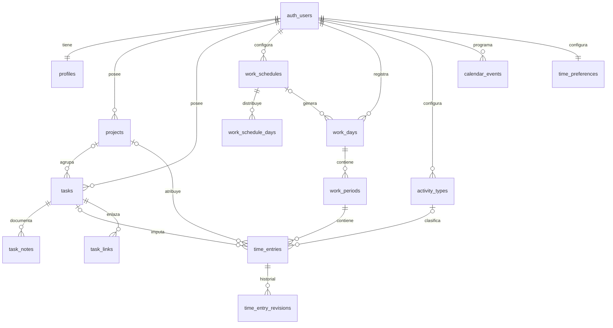

# Modelo de datos propuesto — Chambapp

Estado: propuesta para revisar antes de crear migraciones o interfaz. Versión: 2026-09-24.

## Alcance y supuestos de la primera versión

- Cada persona crea una cuenta y registra sus propios proyectos, tareas y tiempo. No hay equipos ni proyectos compartidos en la primera versión.
- Una jornada (`work_days`) representa un día laboral según la zona horaria guardada en esa jornada. Puede tener varios tramos de presencia (`work_periods`), incluso si alguno cruza medianoche.
- Toda imputación de tiempo pertenece a un tramo de presencia. Al introducir tiempo histórico, la aplicación podrá crear o ajustar el tramo y la jornada en la misma operación.
- Cada minuto registrado tiene un único tipo: tarea, descanso, comida o periodo personalizado. No se permiten imputaciones simultáneas para la misma persona.
- En la primera versión se puede añadir manualmente una URL a una tarea existente o nueva. La lectura automática desde Odoo queda preparada como ampliación futura; no se configura ni se consulta Odoo todavía.
- Una tarea es única por usuario: el mismo título normalizado no puede repetirse, aunque esté archivada o se haya importado desde otra URL. Puede tener tantos partes de horas como sea necesario en fechas distintas.
- Cada tarea tiene un código visible `T` seguido de un número correlativo por usuario (`T1`, `T2`, ...), además de título y proyecto obligatorios.
- Al cerrar el día se puede revisar la jornada, resolver huecos y cronómetros abiertos y marcarla como revisada. Las correcciones de partes conservan un historial.
- El calendario muestra jornadas, partes, vencimientos, festivos y eventos. Solo los festivos marcados para afectar a la planificación modifican el objetivo de la jornada.
- La interfaz usará negro y rojo como colores principales; es una decisión visual y no altera las relaciones de datos.

## Relaciones

`auth_users` representa `auth.users` de Supabase; no se crea otra tabla de contraseñas.

## Tablas

Las claves internas son `uuid` salvo en `tasks`, donde la clave de la tarea es el ID visible `T` + número **dentro de cada usuario**: la PK es `(user_id, id)`. Por ello `T1` de una persona no se confunde con `T1` de otra. Todas las fechas de creación/edición son `timestamptz`, y todas las duraciones configuradas son minutos enteros no negativos. Los intervalos se guardan con inicio y fin `timestamptz`; la duración real se calcula a partir de ellos. Solo se guarda por separado la duración redondeada de cada parte cerrado, para conservar el resultado aplicado en ese momento.

### `profiles`

| Campo | Tipo | Regla |
| --- | --- | --- |
| `user_id` | `uuid` | PK y FK a `auth.users.id` |
| `display_name` | `text` | Opcional |
| `timezone` | `text` | Zona IANA, p. ej. `Europe/Madrid`; obligatoria |
| `next_task_number` | `bigint` | Siguiente número de tarea; comienza en `1` y aumenta de forma transaccional |
| `created_at`, `updated_at` | `timestamptz` | Obligatorios |

La zona horaria del perfil determina el valor inicial de cada jornada. Cambiarla no altera jornadas pasadas.

### `projects`

| Campo | Tipo | Regla |
| --- | --- | --- |
| `id`, `user_id` | `uuid` | PK; `user_id` FK a `auth.users` |
| `name` | `text` | Obligatorio; único entre proyectos activos del usuario sin distinguir mayúsculas |
| `description`, `color` | `text` | Opcionales |
| `status` | `text` | `active`, `paused`, `completed` |
| `archived_at` | `timestamptz` | Opcional; archivar conserva histórico |
| `created_at`, `updated_at` | `timestamptz` | Obligatorios |

### `tasks`

| Campo | Tipo | Regla |
| --- | --- | --- |
| `user_id` | `uuid` | Propietario; forma parte de la PK |
| `id` | `text` | ID de la tarea y parte de la PK: `T` seguido de número positivo (`T1`, `T2`, ...) |
| `task_number` | `bigint` | Número positivo, único por usuario e inmutable |
| `project_id` | `uuid` | FK **obligatoria** a un proyecto del mismo propietario |
| `title` | `text` | Obligatorio |
| `normalized_title` | `text` | Obligatorio; único por usuario, incluidos los archivados |
| `description` | `text` | Opcional; texto o Markdown |
| `status` | `text` | `todo`, `in_progress`, `blocked`, `done`, `cancelled` |
| `priority` | `text` | Opcional: `low`, `medium`, `high`, `urgent` |
| `estimate_minutes` | `integer` | Opcional, no negativo |
| `due_date`, `completed_at` | `date`, `timestamptz` | Opcionales |
| `archived_at` | `timestamptz` | Opcional; conserva imputaciones |
| `created_at`, `updated_at` | `timestamptz` | Obligatorios |

Al crear una tarea se bloquea y aumenta `profiles.next_task_number` dentro de la misma transacción; `id` se genera como `T` + el número asignado y es inmutable. Así dos creaciones simultáneas no reciben el mismo ID. La base impone además `UNIQUE (user_id, task_number)` y el número nunca se reutiliza. `T1` puede existir para dos usuarios distintos porque las relaciones con tareas siempre incluyen `user_id`. `normalized_title` se obtiene de `title` quitando espacios externos, compactando espacios internos y unificando mayúsculas/minúsculas. La base impone también `UNIQUE (user_id, normalized_title)`, incluso en tareas archivadas; una edición que colisione se rechaza. Esta regla evita duplicados de título, sin pretender detectar automáticamente títulos distintos con el mismo significado. El proyecto se debe elegir o crear antes de guardar la tarea. El estado de la tarea es independiente del temporizador.

### `task_notes`

Notas cronológicas de una tarea, independientes de su descripción y de las notas de cada parte de horas.

| Campo | Tipo | Regla |
| --- | --- | --- |
| `id`, `user_id` | `uuid` | PK; propietario |
| `task_id` | `text` | FK compuesta `(user_id, task_id)` a `tasks(user_id, id)` |
| `body` | `text` | Obligatorio; texto o Markdown |
| `created_at`, `updated_at` | `timestamptz` | Obligatorios |

### `time_preferences`

| Campo | Tipo | Regla |
| --- | --- | --- |
| `user_id` | `uuid` | PK y FK a `auth.users.id` |
| `rounding_increment_minutes` | `integer` | `0`, `5`, `10`, `15`, `30` o `60`; `0` conserva el tiempo exacto |
| `created_at`, `updated_at` | `timestamptz` | Obligatorios |

La configuración vigente se aplica al cerrar un parte, no mientras corre el cronómetro. Con un intervalo distinto de cero se redondea **siempre hacia arriba** al siguiente múltiplo, salvo que la duración ya sea múltiplo exacto. El calculador de tiempo usa este ajuste por defecto y permite previsualizar el resultado sin crear datos.

### `task_links`

Enlaces añadidos manualmente a una tarea. Admiten URLs de Odoo desde la primera versión sin requerir acceso a su API.

| Campo | Tipo | Regla |
| --- | --- | --- |
| `id`, `user_id` | `uuid` | PK; propietario |
| `task_id` | `text` | FK compuesta `(user_id, task_id)` a `tasks(user_id, id)` |
| `url` | `text` | URL original para abrir el enlace |
| `normalized_url` | `text` | URL canónica para detectar duplicados exactos |
| `label` | `text` | Etiqueta opcional |
| `created_at`, `updated_at` | `timestamptz` | Obligatorios |

Una tarea puede tener varios enlaces, añadidos al crearla o **después**. `normalized_url` es única por usuario; si ya está en la misma tarea, se muestra el enlace existente, y si está en otra, se informa del conflicto. En esta fase pegar una URL **no** rellena datos automáticamente. El enlace tampoco sobrescribe título, proyecto, descripción ni notas. La identidad técnica de Odoo se añadirá más adelante, cuando se conozca la versión y el formato real de sus URLs.

### `work_schedules`

Versiones de la configuración semanal, para que los cambios futuros no alteren objetivos históricos.

| Campo | Tipo | Regla |
| --- | --- | --- |
| `id`, `user_id` | `uuid` | PK; propietario |
| `effective_from`, `effective_to` | `date` | Vigencia local; `effective_to` opcional y exclusivo; versiones sin solapamiento |
| `weekly_target_minutes` | `integer` | Minutos semanales no negativos; admite, por ejemplo, 37,5 h = 2250 min |
| `created_at`, `updated_at` | `timestamptz` | Obligatorios |

### `work_schedule_days`

| Campo | Tipo | Regla |
| --- | --- | --- |
| `schedule_id` | `uuid` | FK a `work_schedules` |
| `weekday` | `smallint` | 1 = lunes, …, 7 = domingo |

PK `(schedule_id, weekday)`. La persona elige sus días laborables. El objetivo semanal se reparte entre ellos. Si no es divisible en minutos, los minutos sobrantes se asignan por orden de día para que la suma semanal coincida exactamente con `weekly_target_minutes`. Si el objetivo semanal es mayor que cero, debe existir al menos un día laborable.

### `calendar_events`

Festivos y eventos propios que se ven en el calendario.

| Campo | Tipo | Regla |
| --- | --- | --- |
| `id`, `user_id` | `uuid` | PK; propietario |
| `kind` | `text` | `holiday` o `event` |
| `title`, `description` | `text` | Título obligatorio, descripción opcional |
| `all_day` | `boolean` | Distingue fechas completas de intervalos con hora |
| `starts_on`, `ends_on` | `date` | Para día completo; fin exclusivo |
| `starts_at`, `ends_at` | `timestamptz` | Para evento con hora; fin exclusivo |
| `timezone` | `text` | Zona IANA para mostrar el evento |
| `affects_work_target` | `boolean` | Si es festivo y vale `true`, objetivo diario = 0 |
| `created_at`, `updated_at` | `timestamptz` | Obligatorios |

Una restricción exige el par de fechas o el par de instantes, según `all_day`, y un fin posterior al inicio. Los festivos son de día completo en la primera versión. Un evento normal no altera el objetivo de trabajo. Las fiestas pueden abarcar varios días; recurrencias anuales quedan como ampliación posterior para no introducir reglas ambiguas sobre fechas móviles.

### `work_days`

| Campo | Tipo | Regla |
| --- | --- | --- |
| `id`, `user_id` | `uuid` | PK; propietario |
| `work_date` | `date` | Fecha local de inicio; única por usuario |
| `timezone` | `text` | Zona IANA de esa jornada; snapshot |
| `schedule_id` | `uuid` | Versión de horario que generó el objetivo; opcional para jornadas manuales |
| `target_minutes` | `integer` | Objetivo diario calculado o corregido manualmente, no negativo |
| `target_source` | `text` | `schedule`, `holiday` o `manual` |
| `note` | `text` | Opcional |
| `reviewed_at` | `timestamptz` | Opcional; última revisión confirmada por el usuario |
| `review_dirty_at` | `timestamptz` | Último cambio que obliga a revisar de nuevo; opcional |
| `review_note` | `text` | Opcional; comentario de la revisión |
| `created_at`, `updated_at` | `timestamptz` | Obligatorios |

La jornada agrupa registros y fija el objetivo; los tiempos reales proceden de sus tramos. El programa genera jornadas para los días visibles del calendario según la versión de horario vigente: reparto de horas semanales en días laborables, cero en los no laborables y cero en festivos que afecten a la planificación. `target_minutes` y `target_source` quedan como snapshot. Una corrección manual tiene prioridad. Cambiar el horario o añadir un festivo recalcula solo jornadas futuras sin tiempo registrado y sin corrección manual; el histórico permanece estable. No se almacena una duración total editable que pueda contradecir los tramos.

### `work_periods`

| Campo | Tipo | Regla |
| --- | --- | --- |
| `id`, `user_id`, `work_day_id` | `uuid` | PK; jornada del mismo propietario |
| `started_at` | `timestamptz` | Obligatorio |
| `ended_at` | `timestamptz` | Opcional mientras el tramo está abierto; si existe, posterior al inicio |
| `note` | `text` | Opcional |
| `created_at`, `updated_at` | `timestamptz` | Obligatorios |

Permite partir la jornada, por ejemplo 09:00–14:00 y 15:00–18:00. Los tramos de una misma persona no se solapan. Solo puede haber uno abierto por persona. `work_date` corresponde a la fecha local de `started_at`; un tramo puede terminar al día siguiente.

### `activity_types`

Tipos reutilizables para periodos personalizados como reunión, formación o soporte.

| Campo | Tipo | Regla |
| --- | --- | --- |
| `id`, `user_id` | `uuid` | PK; propietario |
| `name` | `text` | Obligatorio; único entre tipos activos del usuario |
| `color` | `text` | Opcional |
| `default_counts_as_work` | `boolean` | Valor inicial para las nuevas imputaciones |
| `archived_at` | `timestamptz` | Opcional; conserva histórico |
| `created_at`, `updated_at` | `timestamptz` | Obligatorios |

### `time_entries`

| Campo | Tipo | Regla |
| --- | --- | --- |
| `id`, `user_id`, `work_period_id` | `uuid` | PK; tramo del mismo propietario |
| `kind` | `text` | `task`, `break`, `meal`, `custom` |
| `task_id` | `text` | Obligatorio solo para `task`; FK compuesta `(user_id, task_id)` a `tasks(user_id, id)` |
| `activity_type_id` | `uuid` | Obligatorio solo para `custom`; tipo del mismo propietario |
| `project_id` | `uuid` | Opcional; proyecto del mismo propietario |
| `counts_as_work` | `boolean` | `true` en tarea, `false` en descanso/comida; en personalizado se copia del tipo al crear la entrada |
| `started_at` | `timestamptz` | Obligatorio |
| `ended_at` | `timestamptz` | Opcional durante cronómetro activo; si existe, posterior al inicio |
| `rounded_seconds` | `integer` | En partes de tarea cerrados: duración aplicada tras el redondeo; no negativo. `NULL` mientras está abierto y en otros tipos |
| `rounding_increment_applied` | `integer` | En partes de tarea cerrados: `0`, `5`, `10`, `15`, `30` o `60` |
| `note` | `text` | Opcional |
| `created_at`, `updated_at` | `timestamptz` | Obligatorios |

`project_id` se copia al registrar la entrada: si una tarea cambia de proyecto, los informes históricos conservan la atribución original. Un periodo personalizado puede atribuirse opcionalmente a un proyecto. Al editar una imputación se puede corregir esa atribución. Cambiar la configuración de un tipo personalizado no reclasifica el pasado, porque `counts_as_work` queda guardado en cada entrada.

Una tarea puede tener **múltiples partes de horas** (`time_entries`) en días distintos. Cada parte conserva inicio, fin, duración real y duración redondeada; no se guarda un total acumulado en `tasks`.

### `time_entry_revisions`

Historial inmutable de cada corrección de un parte de horas.

| Campo | Tipo | Regla |
| --- | --- | --- |
| `id`, `user_id`, `time_entry_id` | `uuid` | PK; parte del mismo propietario |
| `changed_at` | `timestamptz` | Instante del cambio |
| `changed_by` | `uuid` | Usuario que corrigió el parte; en la primera versión coincide con el propietario |
| `before_values`, `after_values` | `jsonb` | Estado anterior y nuevo de los campos auditados |
| `reason` | `text` | Motivo opcional de la corrección |

Se auditan inicio, fin, tarea, proyecto, tipo, tramo de jornada, nota, incremento de redondeo y duración redondeada. Cada corrección y su entrada en este historial se guardan en una sola transacción. El usuario puede leer su historial, pero no editar ni borrar revisiones; su escritura se controla desde la base de datos. Las correcciones vuelven a comprobar solapamientos, pertenencia al tramo y cálculo del redondeo.

### Cronómetro y redondeo de partes

1. Al iniciar un parte se crea una entrada con `started_at` fijado por el servidor y `ended_at = NULL`. La pantalla muestra un cronómetro en vivo calculado como `ahora − started_at`; al recargar, continúa desde el dato persistido.
2. Al finalizar, el servidor fija `ended_at`, lee la configuración vigente, calcula la duración real en segundos y aplica la precisión elegida. Con incremento `0`, `rounded_seconds` coincide con la duración real en segundos. Con `5`, `10`, `15`, `30` o `60`, se redondea **hacia arriba**: `ceil(duración_real_segundos / (incremento_minutos × 60)) × incremento_minutos × 60`. Por ejemplo, 12 min con incremento de 10 se convierten en 20 min; 10 min exactos permanecen en 10.
3. Se guarda el incremento aplicado junto al resultado. Cambiar la preferencia mañana no modifica partes antiguos. Si se corrigen inicio o fin de un parte cerrado, se recalcula con el incremento aplicado originalmente y se deja trazabilidad en `updated_at`.
4. Descansos, comida y periodos personalizados conservan duración real. El redondeo se aplica a partes de tarea para no distorsionar presencia ni pausas.

### Calculador de tiempo

Es una pantalla sin tabla propia: recibe fecha y hora de inicio y fin, calcula la diferencia real y muestra a la vez la duración exacta (`h:mm:ss` y horas decimales) y la duración redondeada (`h:mm` y horas decimales) con el incremento seleccionado. Por ejemplo, 1 h 7 min se muestra también como 1 h 10 min con redondeo hacia arriba a múltiplos de 5. Usa la zona horaria del usuario para interpretar la entrada y `timestamptz` para calcular correctamente cambios de hora. No crea jornada ni parte de horas, ni guarda los valores introducidos.

### Revisión diaria de la jornada

La pantalla de cierre muestra los tramos y partes del día, el objetivo, el tiempo registrado y los huecos sin clasificar (`presencia − imputaciones`). Señala cronómetros abiertos y cruces con eventos del calendario para que el usuario los examine; un cruce con un evento puede ser intencionado y no bloquea por sí solo la revisión. Desde el calendario se pueden crear o corregir partes y tramos. Al terminar, el usuario marca la jornada como revisada y se guarda `work_days.reviewed_at` y, si quiere, `review_note`.

No hace falta una tabla de incidencias: los avisos se calculan desde los intervalos actuales. Una jornada está pendiente si `reviewed_at` es `NULL` o `review_dirty_at > reviewed_at`. Al añadir, corregir, mover o quitar un tramo, un parte o un evento, se actualiza `review_dirty_at` de las jornadas afectadas, incluidas la jornada antigua y la nueva si el registro cambia de fecha. Una jornada con un cronómetro abierto no puede marcarse como revisada. La revisión no modifica automáticamente horas ni tareas; toda corrección queda en el historial del parte.

## Integridad y operaciones

1. Claves foráneas compuestas o comprobaciones equivalentes garantizan que tarea, proyecto, tipo, jornada, tramo e imputación pertenecen al mismo `user_id`.
2. `CHECK` exige las combinaciones válidas de `kind`, `task_id`, `activity_type_id` y `counts_as_work`. También exige `ended_at > started_at` en intervalos cerrados.
3. Restricciones de exclusión sobre rangos `tstzrange` impiden solapar tramos de presencia y, por separado, imputaciones de una misma persona. Una entrada abierta se trata como rango sin fin. Se requiere `btree_gist` para combinar `user_id` con el rango.
4. Una imputación debe quedar dentro de su tramo. Como afecta a dos filas, se valida en una operación transaccional del servidor o con un disparador de base de datos. Al cerrar o acortar un tramo, se valida de nuevo.
5. Iniciar/detener cronómetros y corregir tramos o partes se hace de forma transaccional para evitar estados parciales. Solo hay una imputación abierta por usuario.
6. Proyectos, tareas y tipos con histórico se archivan. El borrado físico de datos con imputaciones asociadas queda restringido; la eliminación de cuenta se define por separado.
7. Los cambios de hora se resuelven almacenando instantes absolutos (`timestamptz`) y usando la zona IANA únicamente para asignar `work_date` y mostrar horas locales.
8. Las versiones de horario semanal no se solapan para un usuario. Los días de una versión son únicos. Los festivos afectan únicamente jornadas futuras sin correcciones manuales ni tiempo registrado.
9. La base de datos impone unicidad del número, del título normalizado y de cada URL normalizada por usuario, incluso si dos peticiones se producen a la vez.
10. El historial de correcciones es de solo lectura para el cliente. La validación y escritura de la revisión ocurren junto al cambio del parte, para que no pueda existir una corrección sin su registro histórico.

## Métricas derivadas

Para un periodo cerrado, `duración real = ended_at - started_at`. Los periodos abiertos muestran duración provisional hasta el instante actual. La zona horaria de la jornada define su agrupación diaria. Los partes que cruzan medianoche se atribuyen a la jornada en la que comenzaron; las vistas por semana y mes agregan jornadas por su `work_date`.

| Métrica | Cálculo |
| --- | --- |
| Presencia | Suma de duración de `work_periods` |
| Tiempo en tareas | Suma real y suma redondeada de partes con `kind = task`, mostradas por separado |
| Descansos / comida | Sumas separadas por `kind` |
| Otros periodos trabajados | Suma de personalizados con `counts_as_work = true` |
| Trabajo neto | Tareas + otros periodos trabajados |
| Tiempo registrado | Suma de todas las imputaciones |
| Tiempo sin clasificar | Presencia − tiempo registrado |
| Cumplimiento diario | Trabajo neto real frente al `target_minutes` de la jornada |
| Cumplimiento semanal/mensual | Suma de trabajo neto real frente a suma de objetivos diarios generados |
| Distribución por proyecto | Suma de imputaciones de tarea según `time_entries.project_id`; los personalizados se muestran por separado |
| Estimado frente a real | `tasks.estimate_minutes` frente a suma de partes reales y redondeados de esa tarea |
| Actividad de tareas | Partes por tarea, días trabajados, tareas por estado, finalizadas, pendientes y vencidas |
| Actividad de proyectos | Tiempo real/redondeado, número de tareas y progreso por estado |
| Revisión de jornadas | Días revisados, pendientes, con huecos o con cronómetro abierto |

El dashboard ofrece vistas diaria, semanal y mensual. Permite filtrar por fechas, proyecto, tarea y estado; las listas de tareas y proyectos pueden ordenarse por nombre, tiempo, número de partes, fecha de actualización, vencimiento o progreso, según corresponda. Las horas de presencia y cumplimiento usan siempre tiempo real; las estadísticas de partes permiten alternar real y redondeado. Los agregados se calculan desde las tablas base, sin guardar contadores redundantes. Si el volumen crece, se pueden añadir agregados/materializaciones tras medir consultas reales.

## Calendario visible

El calendario combina `work_days` y sus tramos, `time_entries`, `tasks.due_date` y `calendar_events`. Distingue festivos, eventos, días laborables, jornadas con objetivo y jornadas registradas. La vista diaria/semanal/mensual es una decisión de interfaz; no requiere duplicar registros en otra tabla.

## Búsqueda e índices iniciales

- Índices B-tree en claves foráneas, `(user_id, work_date)` de jornadas, `(user_id, started_at)` de tramos/imputaciones, `(user_id, status)`, `(user_id, project_id)` y `(user_id, due_date)` de tareas, y fechas de eventos de calendario.
- PK `(user_id, id)` de tareas e índices únicos `(user_id, task_number)`, `(user_id, normalized_title)` y `(user_id, effective_from)` de versiones de horario.
- Índices `(task_id, started_at)` para los partes de una tarea, `(task_id, created_at)` para sus notas y `(time_entry_id, changed_at)` para el historial de correcciones.
- Índice único `(user_id, normalized_url)` para evitar que el mismo enlace quede asociado a varias tareas.
- Búsqueda de tareas por código `T…`, título, descripción y notas. Inicialmente, coincidencia exacta por código y texto completo con configuración `simple` para conservar términos técnicos. Las notas se indexan por separado y se incorporan al resultado por `task_id`, para no duplicar texto de todas las notas en la fila de la tarea. Si el uso demuestra necesidad de fragmentos o tolerancia a erratas, añadir `pg_trgm` e índice GIN específico.
- Filtros por proyecto, estado, prioridad, fechas y archivado; ordenar por actualización o vencimiento.

## Acceso y despliegue

- Autenticación con Supabase Auth. Todas las tablas accesibles desde el cliente usan RLS y políticas por operación que comprueban `auth.uid() = user_id` o la relación de propiedad. El rol `anon` no accede a estos datos.
- Los `GRANT` a `authenticated` se declaran expresamente en las migraciones junto a RLS; la exposición de tablas a la Data API ya no debe suponerse automática.
- El cliente desplegado en Vercel utiliza solo la clave pública de Supabase. El historial de correcciones se crea mediante operaciones controladas en la base de datos y se expone al propietario solo para lectura.

## Preparación para Odoo — fase posterior

La primera versión guarda URLs manuales en `task_links`, sin consultar Odoo, solicitar credenciales ni sincronizar partes. El código visible `T…`, el título y el proyecto siguen siendo obligatorios para cualquier tarea. La integración futura podrá ampliar el modelo sin cambiar estos identificadores ni perder los enlaces existentes:

1. Crear `odoo_connections` con `id`, `user_id`, `base_url`, `database_name` opcional, `api_kind`, referencia a credencial cifrada, estado y fechas de comprobación. Cada usuario tendrá sus propias conexiones; el secreto nunca estará en una tabla expuesta al navegador.
2. Añadir a `task_links` `odoo_connection_id`, `external_model` (por ejemplo `project.task`), `external_id`, `external_status`, `last_fetched_at` y `last_fetch_error`. Imponer unicidad de `(odoo_connection_id, external_model, external_id)` cuando los campos existan. Varias formas de URL del mismo registro se asociarán a una sola tarea local.
3. Al importar, si el título normalizado ya existe para ese usuario, ofrecer enlazarlo a la tarea existente. Si no existe, exigir elegir o crear un proyecto local antes de crear la tarea. La lectura de Odoo no sobrescribirá automáticamente los campos ni las notas de una tarea ya creada.
4. Las llamadas a la API se harán desde servidor, con validación estricta de URL/dominio y credenciales protegidas. La versión, modalidad de alojamiento, permisos y formato real de enlace de Odoo se comprobarán cuando se implemente esta fase.

## Decisiones pendientes antes de implementar

1. ¿El objetivo de jornada mide trabajo neto o presencia? La propuesta compara `target_minutes` con trabajo neto real.
2. Para la futura fase Odoo: versión, tipo de instalación (Online, Odoo.sh o servidor propio), permisos, plan y ejemplo real de URL de tarea. Odoo 19 incorpora la API JSON-2; instalaciones anteriores pueden necesitar la API RPC. En Odoo Online la API externa exige el plan Custom. Estos datos no bloquean la primera versión.
3. ¿Se necesitan informes facturables? Si sí, conviene agregar `billable` a las entradas y quizá tarifas con vigencia temporal.

## Referencias de diseño

- [Supabase: Row Level Security](https://supabase.com/docs/guides/database/postgres/row-level-security)
- [Supabase: cambio en exposición de tablas a la Data API](https://supabase.com/changelog/45329-breaking-change-tables-not-exposed-to-data-and-graphql-api-automatically)
- [Supabase: búsqueda de texto completo](https://supabase.com/docs/guides/database/full-text-search)
- [PostgreSQL: restricciones de exclusión](https://www.postgresql.org/docs/current/rangetypes.html)
- [Odoo 19: API externa JSON-2](https://www.odoo.com/documentation/19.0/developer/reference/external_api.html)
- [Odoo 19: API RPC y transición de versiones](https://www.odoo.com/documentation/19.0/developer/reference/external_rpc_api.html)
- [Supabase: Vault para credenciales](https://supabase.com/docs/guides/database/vault)
