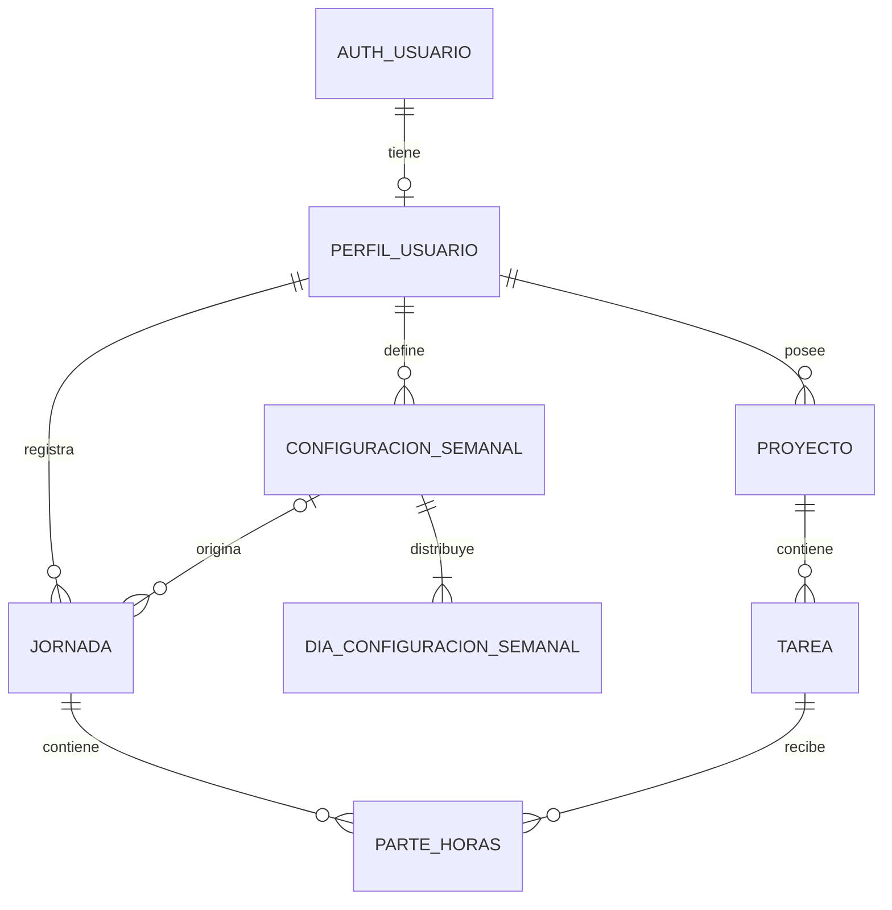

# Chambapp — modelo de datos v1

Primera propuesta relacional para revisar antes de implementar la base de datos. El backend será Supabase, con PostgreSQL y registro de usuarios mediante Supabase Auth.

## Supuestos de esta versión

- Cada usuario gestiona sus propios proyectos, tareas y tiempos. No se incluyen equipos ni proyectos compartidos todavía.
- Cada tarea pertenece a un único proyecto.
- Un parte registra una duración de trabajo para una tarea en una jornada. Una tarea puede tener varios partes, incluso en el mismo día.
- Hay como máximo una jornada por usuario y fecha local.
- Las duraciones se guardan como minutos enteros; las horas se utilizan para mostrarlas en pantalla.
- El reparto inicial distribuye el total semanal entre los días elegidos. No asigna automáticamente tiempo a tareas.
- Se parte de semanas de lunes a domingo, con objetivos diarios que el usuario puede ajustar.

## Entidades

Los identificadores son UUID. `PK` indica clave primaria y `FK`, referencia a otra entidad. Los campos son obligatorios salvo que se marque lo contrario.

### 1. PerfilUsuario (`public.perfiles`)

Supabase Auth gestiona la cuenta en `auth.users`: identidad, credenciales y sesiones. Chambapp mantiene un perfil con los datos propios de la aplicación, vinculado a esa cuenta con el mismo UUID. Cada cuenta de Chambapp tendrá un único perfil.

| Campo | Tipo | Descripción |
|---|---|---|
| id | UUID, PK y FK → auth.users.id | Mismo identificador que la cuenta de Supabase Auth. |
| nombre | Texto | Nombre visible. |
| zona_horaria | Texto | Zona IANA, por ejemplo `Europe/Madrid`, para determinar la fecha de cada jornada. |
| creado_en | Instante UTC | Fecha de creación. |

El email de acceso y las credenciales los gestiona Supabase Auth; no se duplican en el perfil. El método de registro (email y contraseña, enlace por email o proveedor externo) queda pendiente de decidir.

El perfil se creará al registrar la cuenta, con una zona horaria predeterminada y un nombre inicial que se podrán editar. La creación automática debe garantizar que los datos opcionales del registro no provoquen errores que bloqueen el alta. La configuración semanal se define durante la configuración inicial de la app.

Las referencias `usuario_id` de proyectos, configuraciones y jornadas apuntan a `public.perfiles.id`.

### 2. Proyecto

| Campo | Tipo | Descripción |
|---|---|---|
| id | UUID, PK | Identificador del proyecto. |
| usuario_id | UUID, FK → PerfilUsuario | Propietario. |
| nombre | Texto | Nombre del proyecto. |
| descripcion | Texto, opcional | Información adicional. |
| archivado_en | Instante UTC, opcional | Permite retirar el proyecto de las vistas activas conservando su historial. |
| creado_en | Instante UTC | Fecha de creación. |

### 3. Tarea

| Campo | Tipo | Descripción |
|---|---|---|
| id | UUID, PK | Identificador de la tarea. |
| proyecto_id | UUID, FK → Proyecto | Proyecto al que pertenece. |
| titulo | Texto | Nombre de la tarea. |
| descripcion | Texto, opcional | Detalle del trabajo. |
| estado | Enumeración | `pendiente`, `en_curso`, `completada`. |
| estimacion_minutos | Entero, opcional | Tiempo estimado; debe ser mayor o igual a cero. |
| archivado_en | Instante UTC, opcional | Retira la tarea de las vistas activas sin borrar partes. |
| creado_en | Instante UTC | Fecha de creación. |

El propietario se obtiene a través del proyecto. El tiempo trabajado se calcula sumando sus partes.

### 4. ConfiguracionSemanal

Define una versión de la jornada habitual del usuario.

| Campo | Tipo | Descripción |
|---|---|---|
| id | UUID, PK | Identificador de la configuración. |
| usuario_id | UUID, FK → PerfilUsuario | Usuario al que se aplica. |
| minutos_semanales | Entero | Objetivo de trabajo semanal, mayor que cero. |
| vigente_desde | Fecha local | Lunes a partir del cual se aplica esta versión. |
| creado_en | Instante UTC | Fecha de creación. |

La configuración aplicable a una semana es la más reciente cuyo `vigente_desde` no sea posterior a su lunes. La pareja `(usuario_id, vigente_desde)` es única. Cambiar la jornada habitual crea una nueva versión; las versiones usadas se conservan.

### 5. DiaConfiguracionSemanal

Contiene los días seleccionados y el reparto habitual de minutos.

| Campo | Tipo | Descripción |
|---|---|---|
| configuracion_id | UUID, PK y FK → ConfiguracionSemanal | Configuración semanal. |
| dia_semana | Entero, PK | De 1 (lunes) a 7 (domingo). |
| minutos_objetivo | Entero | Minutos asignados al día, mayor que cero. |

La clave primaria es `(configuracion_id, dia_semana)`. Un día no seleccionado no tiene fila. Cada configuración debe tener al menos un día y la suma de sus objetivos debe coincidir con `minutos_semanales`. La configuración y sus días se guardan juntos en una transacción.

### 6. Jornada

Representa un día concreto en el calendario del usuario.

| Campo | Tipo | Descripción |
|---|---|---|
| id | UUID, PK | Identificador de la jornada. |
| usuario_id | UUID, FK → PerfilUsuario | Propietario. |
| fecha | Fecha local | Día de trabajo, sin componente horario. |
| configuracion_id | UUID, FK → ConfiguracionSemanal, opcional | Configuración que originó el objetivo. Vacío en jornadas creadas manualmente. |
| minutos_objetivo | Entero | Objetivo para esa fecha, mayor o igual a cero. |
| notas | Texto, opcional | Observaciones del día. |
| creado_en | Instante UTC | Fecha de creación. |

La pareja `(usuario_id, fecha)` es única. El objetivo se copia al generar la jornada y se puede editar para esa fecha, sin cambiar la configuración habitual. Esto conserva el objetivo histórico aunque cambie la jornada semanal.

Un día sin trabajo previsto puede tener una jornada manual con objetivo cero y partes registrados.

### 7. ParteHoras

Registra el tiempo trabajado en una tarea dentro de una jornada.

| Campo | Tipo | Descripción |
|---|---|---|
| id | UUID, PK | Identificador del parte. |
| jornada_id | UUID, FK → Jornada | Día al que se imputa el trabajo. |
| tarea_id | UUID, FK → Tarea | Tarea realizada. |
| duracion_minutos | Entero | Tiempo trabajado, mayor que cero. |
| descripcion | Texto, opcional | Detalle de lo realizado en ese tramo. |
| creado_en | Instante UTC | Fecha de creación del registro. |
| actualizado_en | Instante UTC | Última modificación. |

En esta primera versión los partes se introducen por duración. No se incluyen horas de inicio y fin ni un cronómetro. El campo `creado_en` no determina el día trabajado: se pueden registrar partes de fechas pasadas.

## Relaciones

## Reglas de integridad

- Una jornada y la tarea de cada uno de sus partes deben pertenecer al mismo usuario, comprobándolo mediante el proyecto.
- La configuración de una jornada, cuando exista, debe pertenecer al mismo usuario.
- Las referencias anteriores y la suma del reparto semanal deben validarse al escribir los datos; las claves foráneas por sí solas no garantizan esas reglas entre entidades.
- No se borran proyectos o tareas con partes asociados; se archivan. No se borran jornadas con partes ni configuraciones usadas por jornadas.
- Archivar un proyecto impide crear nuevas tareas o partes en él. Archivar una tarea impide crear nuevos partes en ella. El historial sigue disponible.
- Una tarea completada puede seguir recibiendo partes, por ejemplo para registrar trabajo realizado antes de completarla.
- Superar el objetivo diario o semanal está permitido: el objetivo sirve para comparar lo previsto con lo trabajado.

## Acceso a los datos en Supabase

Todas las tablas de Chambapp expuestas por la API tendrán Row Level Security (RLS). Los usuarios autenticados solo podrán consultar y modificar sus propios datos; no habrá acceso público a estos registros.

| Entidad | Comprobación de propiedad |
|---|---|
| PerfilUsuario | `id = auth.uid()`. Lectura y edición del perfil propio; el alta automática y el borrado de cuenta se gestionan por flujos específicos. |
| Proyecto, ConfiguracionSemanal y Jornada | `usuario_id = auth.uid()`. |
| Tarea | Su proyecto pertenece al usuario autenticado. |
| DiaConfiguracionSemanal | Su configuración pertenece al usuario autenticado. |
| ParteHoras | Tanto su jornada como el proyecto de su tarea pertenecen al usuario autenticado. |

Las políticas de escritura comprobarán también los valores nuevos para impedir cambiar el propietario o vincular registros a datos ajenos. Las reglas de integridad entre entidades se aplicarán además en la base de datos, incluso en operaciones privilegiadas que omitan RLS.

Las credenciales administrativas de Supabase se reservan para el backend. La baja de cuenta y el tratamiento de su historial se definirán antes de habilitar ese flujo; no se habilita el borrado directo del perfil desde el cliente.

Referencias: [perfiles vinculados a Supabase Auth](https://supabase.com/docs/guides/auth/managing-user-data) y [políticas de acceso RLS](https://supabase.com/docs/guides/database/postgres/row-level-security).

## Reparto inicial y generación de jornadas

1. El usuario introduce sus horas semanales y selecciona los días laborables.
2. La app convierte las horas a minutos y reparte el total por igual entre esos días.
3. Si sobran minutos al dividir, añade un minuto a cada uno de los primeros días seleccionados, en orden de lunes a domingo, hasta agotar el resto.
4. El usuario puede ajustar ese reparto antes de guardar, manteniendo el total semanal.
5. Al preparar una semana, la app genera una jornada para cada día seleccionado y copia su objetivo. Repetir la generación no duplica jornadas ni sobrescribe las existentes.

Ejemplo: **37,5 horas semanales** son **2.250 minutos**. De lunes a viernes, el reparto inicial es **450 minutos (7 h 30 min) por día**.

En un lunes con objetivo de 450 minutos, el usuario podría registrar:

| Proyecto | Tarea | Parte |
|---|---|---|
| Web corporativa | Preparar diseño | 120 min |
| Web corporativa | Implementar portada | 240 min |
| Administración | Preparar documentación | 60 min |

El total trabajado sería **420 minutos**, con **30 minutos pendientes** respecto al objetivo.

Los cambios de configuración se aplican al generar nuevas jornadas. Recalcular jornadas futuras que ya existan requeriría una acción explícita, porque podrían tener ajustes manuales.

## Datos calculados

No se guardan como campos duplicados en esta versión:

- Tiempo trabajado por tarea o proyecto: suma de sus partes.
- Tiempo trabajado por jornada: suma de los partes de esa jornada.
- Tiempo trabajado por semana: suma de los partes de sus jornadas, agrupadas por fecha local.
- Objetivo de una semana concreta: suma de los objetivos de sus jornadas, una vez generada la semana completa.
- Saldo de una jornada: minutos trabajados menos minutos objetivo; positivo indica exceso y negativo, tiempo pendiente.

## Decisiones abiertas para la siguiente revisión

- El método de registro e inicio de sesión y si se requiere confirmar el email.
- El comportamiento de la baja de cuenta y la eliminación de su historial.
- Si habrá equipos y proyectos compartidos.
- Si los partes necesitan hora de inicio y fin, cronómetro o control de solapamientos.
- Si se necesitan festivos, vacaciones, ausencias y turnos que cruzan medianoche.
- Si el reparto semanal debe asignar también tiempo previsto a tareas concretas.
- Si una jornada necesita cierre o aprobación para bloquear modificaciones.

Estas funciones no están incluidas en la v1; pueden añadirse después de revisar el modelo básico.
