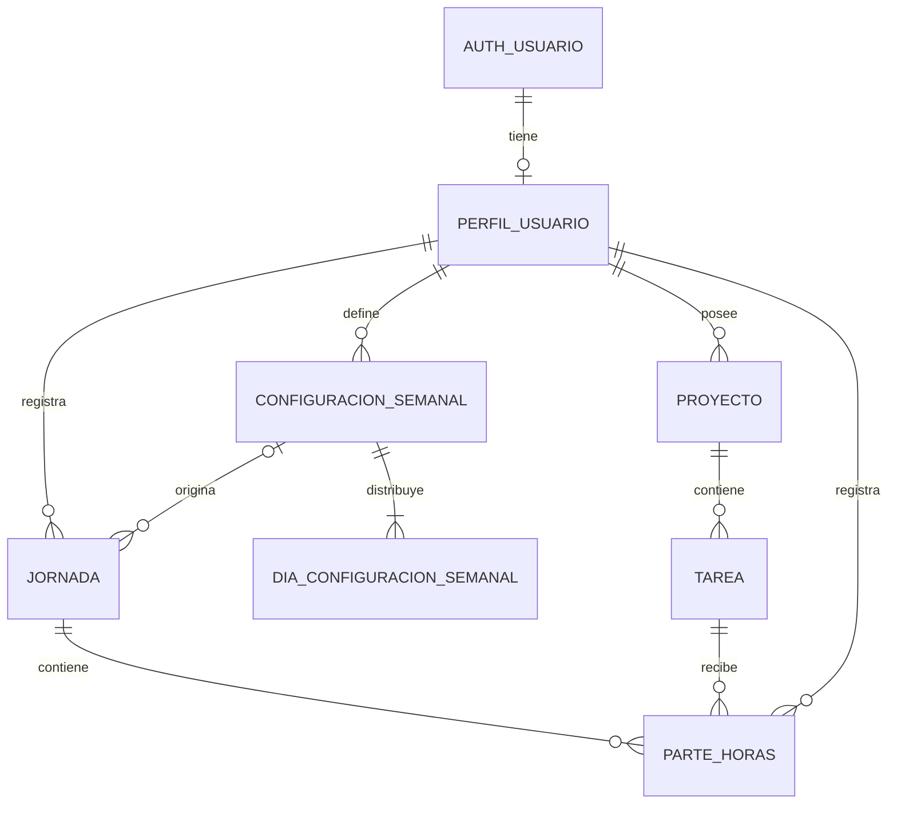

# Chambapp — modelo de datos v2

Segunda propuesta relacional para revisar antes de implementar la base de datos. El backend será Supabase, con PostgreSQL y registro de usuarios mediante Supabase Auth. Esta versión incorpora inicio y fin de los partes y soporte para un cronómetro. La v1 se conserva en `modelo-de-datos-v1.md`.

## Cambios respecto a la v1

- `ParteHoras` incorpora `inicio_en` y `fin_en`; el fin puede estar vacío mientras se trabaja.
- La duración se calcula a partir de esos instantes, sustituyendo el campo editable `duracion_minutos`.
- `ParteHoras` incorpora `usuario_id` para garantizar en la base de datos que cada usuario tenga como máximo un parte en curso.
- Se define cómo iniciar, detener y recuperar el cronómetro, además de registrar intervalos manualmente.
- Se propone impedir solapamientos entre los partes de un mismo usuario.

## Supuestos de esta versión

- Cada usuario gestiona sus propios proyectos, tareas y tiempos. No se incluyen equipos ni proyectos compartidos todavía.
- Cada tarea pertenece a un único proyecto.
- Un parte registra un intervalo continuo de trabajo para una tarea en una jornada. Una tarea puede tener varios partes, incluso en el mismo día.
- Hay como máximo una jornada por usuario y fecha local.
- Los objetivos y estimaciones se guardan como minutos enteros. Los partes guardan instantes con fecha y hora (`timestamptz` en PostgreSQL); su duración se calcula con precisión de segundos y se muestra como horas, minutos y segundos.
- El reparto inicial distribuye el total semanal entre los días elegidos. No asigna automáticamente tiempo a tareas.
- Se parte de semanas de lunes a domingo, con objetivos diarios que el usuario puede ajustar.

## Entidades

Los identificadores son UUID. `PK` indica clave primaria y `FK`, referencia a otra entidad. Los campos son obligatorios salvo que se marque lo contrario.

### 1. PerfilUsuario (`public.perfiles`)

Supabase Auth gestiona la cuenta en `auth.users`: identidad, credenciales y sesiones. Chambapp mantiene un perfil con los datos propios de la aplicación, vinculado a esa cuenta con el mismo UUID. Cada cuenta de Chambapp tendrá un único perfil.

| Campo | Tipo | Descripción |
|---|---|---|
| id | UUID, PK y FK → auth.users.id | Mismo identificador que la cuenta de Supabase Auth. |
| nombre | Texto | Nombre visible. |
| zona_horaria | Texto | Zona IANA, por ejemplo `Europe/Madrid`, para determinar la fecha de cada jornada. |
| creado_en | Instante UTC | Fecha de creación. |

El email de acceso y las credenciales los gestiona Supabase Auth; no se duplican en el perfil. El método de registro (email y contraseña, enlace por email o proveedor externo) queda pendiente de decidir.

El perfil se creará al registrar la cuenta, con una zona horaria predeterminada y un nombre inicial que se podrán editar. La creación automática debe garantizar que los datos opcionales del registro no provoquen errores que bloqueen el alta. La configuración semanal se define durante la configuración inicial de la app.

Las referencias `usuario_id` de proyectos, configuraciones, jornadas y partes apuntan a `public.perfiles.id`.

### 2. Proyecto

| Campo | Tipo | Descripción |
|---|---|---|
| id | UUID, PK | Identificador del proyecto. |
| usuario_id | UUID, FK → PerfilUsuario | Propietario. |
| nombre | Texto | Nombre del proyecto. |
| descripcion | Texto, opcional | Información adicional. |
| archivado_en | Instante UTC, opcional | Permite retirar el proyecto de las vistas activas conservando su historial. |
| creado_en | Instante UTC | Fecha de creación. |

### 3. Tarea

| Campo | Tipo | Descripción |
|---|---|---|
| id | UUID, PK | Identificador de la tarea. |
| proyecto_id | UUID, FK → Proyecto | Proyecto al que pertenece. |
| titulo | Texto | Nombre de la tarea. |
| descripcion | Texto, opcional | Detalle del trabajo. |
| estado | Enumeración | `pendiente`, `en_curso`, `completada`. |
| estimacion_minutos | Entero, opcional | Tiempo estimado; debe ser mayor o igual a cero. |
| archivado_en | Instante UTC, opcional | Retira la tarea de las vistas activas sin borrar partes. |
| creado_en | Instante UTC | Fecha de creación. |

El propietario se obtiene a través del proyecto. El tiempo trabajado se calcula sumando sus partes.

### 4. ConfiguracionSemanal

Define una versión de la jornada habitual del usuario.

| Campo | Tipo | Descripción |
|---|---|---|
| id | UUID, PK | Identificador de la configuración. |
| usuario_id | UUID, FK → PerfilUsuario | Usuario al que se aplica. |
| minutos_semanales | Entero | Objetivo de trabajo semanal, mayor que cero. |
| vigente_desde | Fecha local | Lunes a partir del cual se aplica esta versión. |
| creado_en | Instante UTC | Fecha de creación. |

La configuración aplicable a una semana es la más reciente cuyo `vigente_desde` no sea posterior a su lunes. La pareja `(usuario_id, vigente_desde)` es única. Cambiar la jornada habitual crea una nueva versión; las versiones usadas se conservan.

### 5. DiaConfiguracionSemanal

Contiene los días seleccionados y el reparto habitual de minutos.

| Campo | Tipo | Descripción |
|---|---|---|
| configuracion_id | UUID, PK y FK → ConfiguracionSemanal | Configuración semanal. |
| dia_semana | Entero, PK | De 1 (lunes) a 7 (domingo). |
| minutos_objetivo | Entero | Minutos asignados al día, mayor que cero. |

La clave primaria es `(configuracion_id, dia_semana)`. Un día no seleccionado no tiene fila. Cada configuración debe tener al menos un día y la suma de sus objetivos debe coincidir con `minutos_semanales`. La configuración y sus días se guardan juntos en una transacción.

### 6. Jornada

Representa un día concreto en el calendario del usuario.

| Campo | Tipo | Descripción |
|---|---|---|
| id | UUID, PK | Identificador de la jornada. |
| usuario_id | UUID, FK → PerfilUsuario | Propietario. |
| fecha | Fecha local | Día de trabajo, sin componente horario. |
| configuracion_id | UUID, FK → ConfiguracionSemanal, opcional | Configuración que originó el objetivo. Vacío en jornadas creadas manualmente. |
| minutos_objetivo | Entero | Objetivo para esa fecha, mayor o igual a cero. |
| notas | Texto, opcional | Observaciones del día. |
| creado_en | Instante UTC | Fecha de creación. |

La pareja `(usuario_id, fecha)` es única. El objetivo se copia al generar la jornada y se puede editar para esa fecha, sin cambiar la configuración habitual. Esto conserva el objetivo histórico aunque cambie la jornada semanal.

Un día sin trabajo previsto puede tener una jornada manual con objetivo cero y partes registrados.

### 7. ParteHoras

Registra el tiempo trabajado en una tarea dentro de una jornada.

| Campo | Tipo | Descripción |
|---|---|---|
| id | UUID, PK | Identificador del parte. |
| usuario_id | UUID, FK → PerfilUsuario | Propietario; debe coincidir con el de la jornada y el proyecto de la tarea. |
| jornada_id | UUID, FK → Jornada | Día al que se imputa el trabajo. |
| tarea_id | UUID, FK → Tarea | Tarea realizada. |
| inicio_en | Instante (`timestamptz`) | Fecha y hora de inicio del trabajo. |
| fin_en | Instante (`timestamptz`), opcional | Fecha y hora de fin. `NULL` indica un parte en curso. |
| descripcion | Texto, opcional | Detalle de lo realizado en ese tramo. |
| creado_en | Instante UTC | Fecha de creación del registro. |
| actualizado_en | Instante UTC | Última modificación. |

Se guardan instantes completos, no solo una hora del día, para poder representar trabajo que cruza medianoche y cambios de horario. Se muestran en la zona horaria del usuario. `creado_en` es la fecha de creación del registro, que puede ser distinta de `inicio_en` en un parte introducido manualmente.

El estado se deduce del fin: `fin_en IS NULL` significa **en curso** y un fin informado significa **finalizado**. No se guarda un estado adicional ni una duración editable que pueda contradecir el intervalo.

Como criterio inicial, todo el intervalo se imputa a la jornada correspondiente a la fecha local de inicio. Si cruza medianoche, sigue en esa jornada; no se divide automáticamente. La fecha de la jornada ya asignada no se recalcula cuando el usuario cambia su zona horaria. El reparto entre días de los turnos nocturnos queda pendiente de revisión.

### Funcionamiento del cronómetro

1. **Iniciar:** una operación de backend obtiene el usuario de la sesión, comprueba la propiedad de la tarea, obtiene o crea la jornada y crea un parte con `inicio_en` tomado del reloj del servidor y `fin_en = NULL`.
2. **Mostrar:** el frontend calcula el tiempo transcurrido desde `inicio_en` y actualiza la pantalla cada segundo. No escribe en la base de datos cada segundo. Puede ajustar su reloj con una referencia de hora del servidor para reducir diferencias entre dispositivos.
3. **Detener:** el backend establece `fin_en` usando el reloj del servidor. La operación solo cambia un parte propio cuyo fin siga vacío. Una segunda petición de detener devuelve el parte ya finalizado sin modificar su fin.
4. **Recuperar:** al abrir o recargar la app, se consulta el parte propio con fin vacío. El cronómetro se reconstruye desde su inicio y continúa aunque la pestaña se haya cerrado.
5. **Registro manual:** el usuario introduce inicio y fin para registrar o corregir trabajo ya realizado. Se validan los mismos límites y solapamientos.

Como propuesta para la v2, solo puede haber un cronómetro activo por usuario, también entre pestañas y dispositivos. Para cambiar de tarea se detiene el parte actual y se inicia otro. La operación de inicio debe serializarse por usuario y ser idempotente ante reintentos, para que un doble clic no cree partes duplicados.

La base de datos impondrá un índice único parcial sobre `usuario_id` donde `fin_en IS NULL`. El frontend puede deshabilitar el botón mientras inicia, pero la garantía de un único parte activo reside en la base de datos.

No se añade un estado de pausa: una pausa termina el parte actual y reanudar crea otro para la misma tarea. La suma de esos partes representa el tiempo trabajado, excluyendo el descanso.

## Relaciones

## Reglas de integridad

- Una jornada y la tarea de cada uno de sus partes deben pertenecer al mismo usuario, comprobándolo mediante el proyecto.
- El `usuario_id` del parte debe coincidir con ese propietario. No se puede cambiar el propietario de una tarea o proyecto si eso deja sus partes vinculados a otro usuario.
- Cuando existe `fin_en`, debe ser posterior a `inicio_en`. El registro manual no admite fechas de trabajo futuras; las operaciones del cronómetro usan la hora del servidor.
- Cada usuario puede tener como máximo un parte con `fin_en = NULL`.
- Como propuesta, los intervalos de un mismo usuario no pueden solaparse, ni siquiera entre tareas o jornadas distintas. Se consideran intervalos `[inicio, fin)`: uno puede empezar exactamente cuando termina otro. Un parte abierto ocupa desde su inicio en adelante hasta cerrarse.
- La ausencia de solapamientos se impone en PostgreSQL mediante una restricción de exclusión por usuario e intervalo, también al editar. Una comprobación solo en el frontend no protege frente a peticiones simultáneas.
- La configuración de una jornada, cuando exista, debe pertenecer al mismo usuario.
- Las referencias anteriores y la suma del reparto semanal deben validarse al escribir los datos; las claves foráneas por sí solas no garantizan esas reglas entre entidades.
- No se borran proyectos o tareas con partes asociados; se archivan. No se borran jornadas con partes ni configuraciones usadas por jornadas.
- Archivar un proyecto impide crear nuevas tareas o partes en él. Archivar una tarea impide crear nuevos partes en ella. El historial sigue disponible.
- Antes de archivar una tarea o su proyecto se debe detener cualquier parte en curso asociado. No se permite archivar mientras lo haya.
- Una tarea completada puede seguir recibiendo partes, por ejemplo para registrar trabajo realizado antes de completarla.
- Superar el objetivo diario o semanal está permitido: el objetivo sirve para comparar lo previsto con lo trabajado.

## Acceso a los datos en Supabase

Todas las tablas de Chambapp expuestas por la API tendrán Row Level Security (RLS). Los usuarios autenticados solo podrán consultar y modificar sus propios datos; no habrá acceso público a estos registros.

| Entidad | Comprobación de propiedad |
|---|---|
| PerfilUsuario | `id = auth.uid()`. Lectura y edición del perfil propio; el alta automática y el borrado de cuenta se gestionan por flujos específicos. |
| Proyecto, ConfiguracionSemanal y Jornada | `usuario_id = auth.uid()`. |
| Tarea | Su proyecto pertenece al usuario autenticado. |
| DiaConfiguracionSemanal | Su configuración pertenece al usuario autenticado. |
| ParteHoras | `usuario_id = auth.uid()` y tanto su jornada como el proyecto de su tarea pertenecen al usuario autenticado. |

Las políticas de escritura comprobarán también los valores nuevos para impedir cambiar el propietario o vincular registros a datos ajenos. Las reglas de integridad entre entidades se aplicarán además en la base de datos, incluso en operaciones privilegiadas que omitan RLS. Iniciar y detener el cronómetro se realizarán mediante operaciones transaccionales de backend que validen la sesión y mantengan estas reglas.

Las credenciales administrativas de Supabase se reservan para el backend. La baja de cuenta y el tratamiento de su historial se definirán antes de habilitar ese flujo; no se habilita el borrado directo del perfil desde el cliente.

Referencias: [perfiles vinculados a Supabase Auth](https://supabase.com/docs/guides/auth/managing-user-data) y [políticas de acceso RLS](https://supabase.com/docs/guides/database/postgres/row-level-security).

Para los intervalos se utilizarán los [tipos de fecha y hora de PostgreSQL](https://www.postgresql.org/docs/current/datatype-datetime.html) y sus [rangos y restricciones de exclusión](https://www.postgresql.org/docs/current/rangetypes.html).

## Reparto inicial y generación de jornadas

1. El usuario introduce sus horas semanales y selecciona los días laborables.
2. La app convierte las horas a minutos y reparte el total por igual entre esos días.
3. Si sobran minutos al dividir, añade un minuto a cada uno de los primeros días seleccionados, en orden de lunes a domingo, hasta agotar el resto.
4. El usuario puede ajustar ese reparto antes de guardar, manteniendo el total semanal.
5. Al preparar una semana, la app genera una jornada para cada día seleccionado y copia su objetivo. Repetir la generación no duplica jornadas ni sobrescribe las existentes.

Ejemplo: **37,5 horas semanales** son **2.250 minutos**. De lunes a viernes, el reparto inicial es **450 minutos (7 h 30 min) por día**.

En un lunes con objetivo de 450 minutos, el usuario podría registrar:

| Proyecto | Tarea | Inicio local | Fin local | Duración calculada |
|---|---|---|---|---|
| Web corporativa | Preparar diseño | 09:00 | 11:00 | 120 min |
| Web corporativa | Implementar portada | 11:00 | 15:00 | 240 min |
| Administración | Preparar documentación | 15:30 | 16:30 | 60 min |

El total trabajado sería **420 minutos**, con **30 minutos pendientes** respecto al objetivo.

Los cambios de configuración se aplican al generar nuevas jornadas. Recalcular jornadas futuras que ya existan requeriría una acción explícita, porque podrían tener ajustes manuales.

## Datos calculados

No se guardan como campos duplicados en esta versión:

- Duración finalizada de un parte: `fin_en - inicio_en`, expresada en segundos.
- Tiempo provisional de un parte en curso: instante actual menos `inicio_en`.
- Tiempo trabajado por tarea o proyecto: suma de las duraciones de sus partes finalizados.
- Tiempo trabajado por jornada: suma de las duraciones de sus partes finalizados.
- Tiempo trabajado por semana: suma de las duraciones finalizadas de sus jornadas, agrupadas por la fecha de jornada asignada.
- Objetivo de una semana concreta: suma de los objetivos de sus jornadas, una vez generada la semana completa.
- Saldo de una jornada: minutos trabajados menos minutos objetivo; positivo indica exceso y negativo, tiempo pendiente.

El panel diario puede mostrar además un total en vivo que incluya el parte en curso, identificado como provisional. Para comparar con objetivos en minutos se convierte la suma de segundos al final; no se redondea cada parte, evitando pérdida acumulada de tiempo.

## Decisiones abiertas para la siguiente revisión

- El método de registro e inicio de sesión y si se requiere confirmar el email.
- El comportamiento de la baja de cuenta y la eliminación de su historial.
- Si habrá equipos y proyectos compartidos.
- Confirmar las propuestas de un solo cronómetro activo y ausencia de solapamientos por usuario.
- Si se necesitan festivos, vacaciones, ausencias y turnos que cruzan medianoche.
- Si el reparto semanal debe asignar también tiempo previsto a tareas concretas.
- Si una jornada necesita cierre o aprobación para bloquear modificaciones.

Estas decisiones quedan pendientes de revisar. Este documento define el modelo v2; todavía no se han creado tablas ni migraciones en Supabase.
