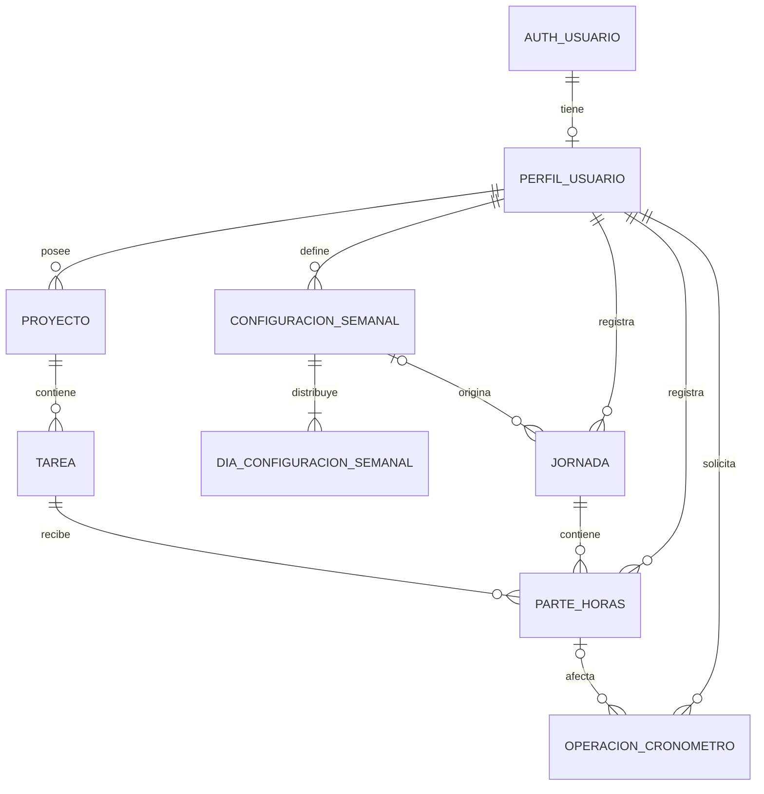

# Chambapp — modelo de datos v3

Tercera propuesta relacional para revisar antes de implementar la base de datos. El backend será Supabase, con PostgreSQL y registro de usuarios mediante Supabase Auth. Se conservan los documentos v1 y v2.

## Cambios respecto a la v2

- Redondeo configurable a bloques del reloj de 5, 10 o 15 minutos, conservando también el intervalo real.
- Zona horaria editable en el perfil y conservada en cada jornada.
- Edición y eliminación de proyectos, tareas y partes, con control de modificaciones simultáneas.
- Inicio y fin resistentes a reintentos y respuestas perdidas, con un registro de operaciones del cronómetro.
- Una misma tarea puede recibir partes en distintas jornadas; no tiene una fecha de trabajo única.

El redondeo confirmado ajusta tanto el inicio como el fin hacia arriba, al siguiente límite del intervalo elegido.

## Supuestos de esta versión

- Cada usuario gestiona sus propios proyectos, tareas y tiempos. No se incluyen equipos ni proyectos compartidos todavía.
- Cada tarea pertenece a un único proyecto.
- Un parte registra un intervalo continuo de trabajo para una tarea en una jornada. Una misma tarea puede tener varios partes el mismo día y en días distintos.
- Hay como máximo una jornada por usuario y fecha local.
- Los objetivos y estimaciones se guardan como minutos enteros. Los partes guardan instantes con fecha y hora (`timestamptz` en PostgreSQL); su duración se calcula con precisión de segundos y se muestra como horas, minutos y segundos.
- El reparto inicial distribuye el total semanal entre los días elegidos. No asigna automáticamente tiempo a tareas.
- Se parte de semanas de lunes a domingo, con objetivos diarios que el usuario puede ajustar.

## Entidades

Los identificadores son UUID. `PK` indica clave primaria y `FK`, referencia a otra entidad. Los campos son obligatorios salvo que se marque lo contrario.

### 1. PerfilUsuario (`public.perfiles`)

Supabase Auth gestiona la cuenta en `auth.users`: identidad, credenciales y sesiones. Chambapp mantiene un perfil con los datos propios de la aplicación, vinculado a esa cuenta con el mismo UUID. Cada cuenta de Chambapp tendrá un único perfil.

| Campo                      | Tipo                          | Descripción                                                                                                                                                 |
| -------------------------- | ----------------------------- | ----------------------------------------------------------------------------------------------------------------------------------------------------------- |
| id                         | UUID, PK y FK → auth.users.id | Mismo identificador que la cuenta de Supabase Auth.                                                                                                         |
| nombre                     | Texto                         | Nombre visible.                                                                                                                                             |
| zona_horaria               | Texto                         | Zona IANA, por ejemplo `Europe/Madrid`, para determinar la fecha de cada jornada.                                                                           |
| intervalo_redondeo_minutos | Entero                        | Uno de `5`, `10` o `15`. Propuesta de valor inicial: `15`.                                                                                                  |
| modo_redondeo              | Valor fijo                    | `superior`: inicio y fin hacia arriba. Se conserva como dato explícito para mantener la interpretación histórica si se incorporan otros modos en el futuro. |
| creado_en                  | Instante UTC                  | Fecha de creación.                                                                                                                                          |

El email de acceso y las credenciales los gestiona Supabase Auth; no se duplican en el perfil. El método de registro (email y contraseña, enlace por email o proveedor externo) queda pendiente de decidir.

El perfil se creará al registrar la cuenta, con una zona horaria predeterminada y un nombre inicial que se podrán editar. La creación automática debe garantizar que los datos opcionales del registro no provoquen errores que bloqueen el alta. La configuración semanal se define durante la configuración inicial de la app.

Las referencias `usuario_id` de proyectos, configuraciones, jornadas y partes apuntan a `public.perfiles.id`.

La zona horaria se configura durante el alta y se puede cambiar en ajustes. Se valida contra el catálogo de zonas admitidas; no se guarda un desplazamiento fijo como `UTC+2`. Los cambios de preferencias se aplican a los nuevos partes. No se recalculan los partes históricos automáticamente.

### Campos comunes para edición y eliminación

Proyecto, Tarea y ParteHoras incorporan además:

| Campo          | Tipo                   | Descripción                                                                                                     |
| -------------- | ---------------------- | --------------------------------------------------------------------------------------------------------------- |
| eliminado_en   | Instante UTC, opcional | Vacío mientras el registro está disponible. Al eliminarlo desaparece de las vistas habituales y de los totales. |
| actualizado_en | Instante UTC           | Última modificación, establecida por el backend.                                                                |
| version        | Entero                 | Empieza en 1 y aumenta en cada modificación; permite detectar ediciones simultáneas.                            |

En ParteHoras, `actualizado_en` ya existía en la v2. El borrado lógico permite eliminar desde la app conservando referencias internas para recuperar errores y resolver reintentos. No equivale a la eliminación definitiva de datos al dar de baja la cuenta, que se definirá aparte.

### 2. Proyecto

| Campo        | Tipo                     | Descripción                                                                 |
| ------------ | ------------------------ | --------------------------------------------------------------------------- |
| id           | UUID, PK                 | Identificador del proyecto.                                                 |
| usuario_id   | UUID, FK → PerfilUsuario | Propietario.                                                                |
| nombre       | Texto                    | Nombre del proyecto.                                                        |
| descripcion  | Texto, opcional          | Información adicional.                                                      |
| archivado_en | Instante UTC, opcional   | Permite retirar el proyecto de las vistas activas conservando su historial. |
| creado_en    | Instante UTC             | Fecha de creación.                                                          |

### 3. Tarea

| Campo              | Tipo                   | Descripción                                              |
| ------------------ | ---------------------- | -------------------------------------------------------- |
| id                 | UUID, PK               | Identificador de la tarea.                               |
| proyecto_id        | UUID, FK → Proyecto    | Proyecto al que pertenece.                               |
| titulo             | Texto                  | Nombre de la tarea.                                      |
| descripcion        | Texto, opcional        | Detalle del trabajo.                                     |
| estado             | Enumeración            | `pendiente`, `en_curso`, `completada`.                   |
| estimacion_minutos | Entero, opcional       | Tiempo estimado; debe ser mayor o igual a cero.          |
| archivado_en       | Instante UTC, opcional | Retira la tarea de las vistas activas sin borrar partes. |
| creado_en          | Instante UTC           | Fecha de creación.                                       |

El propietario se obtiene a través del proyecto. El tiempo trabajado se calcula sumando sus partes no eliminados. Una tarea puede durar varios días: cada parte indica cuándo se trabajó y a qué jornada corresponde. No se duplica la tarea para cada día.

### 4. ConfiguracionSemanal

Define una versión de la jornada habitual del usuario.

| Campo             | Tipo                     | Descripción                                     |
| ----------------- | ------------------------ | ----------------------------------------------- |
| id                | UUID, PK                 | Identificador de la configuración.              |
| usuario_id        | UUID, FK → PerfilUsuario | Usuario al que se aplica.                       |
| minutos_semanales | Entero                   | Objetivo de trabajo semanal, mayor que cero.    |
| vigente_desde     | Fecha local              | Lunes a partir del cual se aplica esta versión. |
| creado_en         | Instante UTC             | Fecha de creación.                              |

La configuración aplicable a una semana es la más reciente cuyo `vigente_desde` no sea posterior a su lunes. La pareja `(usuario_id, vigente_desde)` es única. Cambiar la jornada habitual crea una nueva versión; las versiones usadas se conservan.

### 5. DiaConfiguracionSemanal

Contiene los días seleccionados y el reparto habitual de minutos.

| Campo            | Tipo                                 | Descripción                               |
| ---------------- | ------------------------------------ | ----------------------------------------- |
| configuracion_id | UUID, PK y FK → ConfiguracionSemanal | Configuración semanal.                    |
| dia_semana       | Entero, PK                           | De 1 (lunes) a 7 (domingo).               |
| minutos_objetivo | Entero                               | Minutos asignados al día, mayor que cero. |

La clave primaria es `(configuracion_id, dia_semana)`. Un día no seleccionado no tiene fila. Cada configuración debe tener al menos un día y la suma de sus objetivos debe coincidir con `minutos_semanales`. La configuración y sus días se guardan juntos en una transacción.

### 6. Jornada

Representa un día concreto en el calendario del usuario.

| Campo            | Tipo                                      | Descripción                                                                                      |
| ---------------- | ----------------------------------------- | ------------------------------------------------------------------------------------------------ |
| id               | UUID, PK                                  | Identificador de la jornada.                                                                     |
| usuario_id       | UUID, FK → PerfilUsuario                  | Propietario.                                                                                     |
| fecha            | Fecha local                               | Día de trabajo, sin componente horario.                                                          |
| zona_horaria     | Texto                                     | Zona IANA copiada al crear la jornada; se conserva para interpretar sus partes y límites de día. |
| configuracion_id | UUID, FK → ConfiguracionSemanal, opcional | Configuración que originó el objetivo. Vacío en jornadas creadas manualmente.                    |
| minutos_objetivo | Entero                                    | Objetivo para esa fecha, mayor o igual a cero.                                                   |
| notas            | Texto, opcional                           | Observaciones del día.                                                                           |
| creado_en        | Instante UTC                              | Fecha de creación.                                                                               |

La pareja `(usuario_id, fecha)` es única. El objetivo se copia al generar la jornada y se puede editar para esa fecha, sin cambiar la configuración habitual. Esto conserva el objetivo histórico aunque cambie la jornada semanal.

Un día sin trabajo previsto puede tener una jornada manual con objetivo cero y partes registrados.

Cambiar la zona horaria del perfil no cambia fechas ni zonas de jornadas existentes. Las nuevas jornadas usan la preferencia actual. Si ya existe una jornada para una fecha, se conserva su zona; el frontend la indica cuando difiere de la preferencia actual. Cualquier conversión del historial requiere una acción explícita posterior.

### 7. ParteHoras

Registra el tiempo trabajado en una tarea dentro de una jornada.

| Campo                      | Tipo                               | Descripción                                                                 |
| -------------------------- | ---------------------------------- | --------------------------------------------------------------------------- |
| id                         | UUID, PK                           | Identificador del parte.                                                    |
| usuario_id                 | UUID, FK → PerfilUsuario           | Propietario; debe coincidir con el de la jornada y el proyecto de la tarea. |
| jornada_id                 | UUID, FK → Jornada                 | Día al que se imputa el trabajo.                                            |
| tarea_id                   | UUID, FK → Tarea                   | Tarea realizada.                                                            |
| inicio_en                  | Instante (`timestamptz`)           | Fecha y hora de inicio del trabajo.                                         |
| fin_en                     | Instante (`timestamptz`), opcional | Fecha y hora de fin. `NULL` indica un parte en curso.                       |
| intervalo_redondeo_minutos | Entero                             | Copia del intervalo configurado al crear el parte: `5`, `10` o `15`.        |
| modo_redondeo              | Valor fijo                         | `superior`, copiado al crear el parte.                                      |
| descripcion                | Texto, opcional                    | Detalle de lo realizado en ese tramo.                                       |
| creado_en                  | Instante UTC                       | Fecha de creación del registro.                                             |
| actualizado_en             | Instante UTC                       | Última modificación.                                                        |

Se guardan instantes completos, no solo una hora del día, para poder representar trabajo que cruza medianoche y cambios de horario. Para imputación y redondeo se usa la zona guardada en la jornada. `creado_en` es la fecha de creación del registro, que puede ser distinta de `inicio_en` en un parte introducido manualmente.

El estado de un parte no eliminado se deduce del fin: `fin_en IS NULL` significa **en curso** y un fin informado significa **finalizado**. No se guarda un estado adicional ni una duración editable que pueda contradecir el intervalo. Un registro con `eliminado_en` informado no representa un cronómetro activo.

Como criterio inicial, todo el intervalo se imputa a la jornada correspondiente a la fecha local de inicio. Si cruza medianoche, sigue en esa jornada; no se divide automáticamente. La fecha de la jornada ya asignada no se recalcula cuando el usuario cambia su zona horaria. El reparto entre días de los turnos nocturnos queda pendiente de revisión.

### Redondeo de los partes

El redondeo se aplica a las horas del reloj, no simplemente a la duración. Con 15 minutos, los límites son `:00`, `:15`, `:30` y `:45`; con 10, `:00`, `:10`, …, `:50`; con 5, `:00`, `:05`, …, `:55`. Una hora exactamente sobre el límite no se modifica; los segundos también cuentan para determinar si se ha sobrepasado.

Se conservan `inicio_en` y `fin_en` reales. Se calculan `inicio_imputado_en`, `fin_imputado_en` y `duracion_imputada_segundos` para mostrar y sumar el tiempo redondeado. Esos valores no sustituyen los instantes reales ni alteran el cronómetro.

| Intervalo | Parte real  | Parte imputado | Duración imputada |
| --------- | ----------- | -------------- | ----------------- |
| 15 min    | 09:07–09:38 | 09:15–09:45    | 30 min            |
| 10 min    | 09:07–09:38 | 09:10–09:40    | 30 min            |
| 5 min     | 09:07–09:38 | 09:10–09:40    | 30 min            |

Un parte corto puede quedar con duración imputada cero: por ejemplo, 09:07–09:12 se convierte en 09:15–09:15 con bloques de 15 minutos. No se le añade un bloque mínimo. El cronómetro sigue mostrando el tiempo real y, al cerrar, la app muestra también la duración imputada.

Las preferencias se copian en cada parte para que cambiarlas mañana no modifique los totales de ayer. Editar sus horas recalcula el resultado con sus preferencias guardadas. Aplicar nuevas preferencias al historial sería una acción separada y explícita.

Los solapamientos se validan sobre el intervalo real. Los intervalos redondeados pueden coincidir aunque los reales no se solapen; los totales imputados suman cada parte y pueden diferir del tiempo real. La interfaz debe distinguir ambos valores.

En cambios de horario estacional, los límites se resuelven como instantes reales de la zona de la jornada: se descartan horas inexistentes y se distingue cada aparición de una hora repetida por su desplazamiento UTC. Se elige el primer límite válido que no preceda al instante real. El cálculo devuelve instantes, no horas locales sin contexto.

### Funcionamiento del cronómetro y fallos de conexión

1. **Preparar petición:** el cliente crea un `operacion_id` UUID y guarda localmente la intención antes de enviarla. Los reintentos conservan ese identificador y los mismos parámetros.
2. **Iniciar:** en una transacción, el backend valida la sesión y la tarea, obtiene o crea la jornada, crea el parte con hora del servidor y registra el resultado de la operación. Devuelve parte, versión y referencia de hora del servidor.
3. **Mostrar:** el frontend calcula el tiempo real desde `inicio_en` y actualiza la pantalla cada segundo. No escribe cada segundo. Mientras espera confirmación muestra «iniciando»; no presenta un inicio pendiente como confirmado.
4. **Detener:** otra operación identificada establece `fin_en` con hora del servidor solo si el parte propio sigue abierto y no eliminado. Registra el resultado en la misma transacción. Si ya estaba detenido, devuelve su fin existente sin cambiarlo.
5. **Respuesta perdida:** el cliente reenvía la misma operación o consulta su resultado. Si el servidor ya la completó, recibe el mismo resultado sin crear otro parte ni modificar las horas.
6. **Recuperar:** al recargar, el cliente recupera las intenciones locales pendientes, consulta sus resultados y el parte abierto del usuario. Reconcilia el estado antes de habilitar otro inicio. Otro dispositivo consulta el mismo estado persistido.
7. **Sin conexión:** no se inicia un nuevo parte confirmado. Si falla una parada, se conserva la intención y se muestra «parada pendiente»; no se afirma que se haya guardado. Tras reconectar se consulta y reintenta. Si el servidor nunca recibió la petición, el fin será la hora de recepción del reintento; se ofrece corregirlo manualmente a la hora en que el usuario quiso parar.
8. **Registro manual:** el usuario puede introducir o corregir inicio y fin reales, con validaciones de propiedad, versión y solapamientos.

Esto protege frente a operaciones duplicadas y resultados inciertos, pero no convierte una falta de conexión en un guardado garantizado. La intención local incluye la hora del clic como referencia para corregir después; esa hora no se acepta automáticamente como hora fiable del servidor.

Solo puede haber un cronómetro activo por usuario, también entre pestañas y dispositivos. Para cambiar de tarea se detiene el parte actual y se inicia otro. Las operaciones se serializan por usuario. Un inicio distinto mientras existe un parte activo devuelve ese conflicto, sin crear otro.

La base de datos impondrá un índice único parcial sobre `usuario_id` donde `fin_en IS NULL AND eliminado_en IS NULL`. Las operaciones usarán autenticación y transacciones en el backend; no basta con deshabilitar botones.

No se añade un estado de pausa: una pausa termina el parte actual y reanudar crea otro para la misma tarea. La suma de esos partes representa el tiempo trabajado, excluyendo el descanso.

### 8. OperacionCronometro

Registro interno del resultado de cada petición, para resolver reintentos sin repetir sus efectos.

| Campo      | Tipo                            | Descripción                                                                       |
| ---------- | ------------------------------- | --------------------------------------------------------------------------------- |
| id         | UUID, PK                        | `operacion_id` generado por el cliente, estable en los reintentos.                |
| usuario_id | UUID, FK → PerfilUsuario        | Usuario obtenido de la sesión.                                                    |
| tipo       | Enumeración                     | `iniciar` o `detener`.                                                            |
| parametros | JSON                            | Parámetros de la petición, para detectar reutilización del ID con otra intención. |
| parte_id   | UUID, FK → ParteHoras, opcional | Parte creado o afectado cuando corresponda.                                       |
| resultado  | JSON                            | Resultado confirmado o conflicto estable, con las horas y versión devueltas.      |
| creado_en  | Instante UTC                    | Instante de procesamiento en el servidor.                                         |

El resultado se guarda junto con el efecto en una sola transacción. Si esta falla no se guarda ninguno. Una petición repetida con el mismo ID y parámetros devuelve el resultado persistido; el mismo ID con otros parámetros se rechaza. Si el parte fue editado o eliminado después, el cliente recupera también su estado actual; un reintento nunca restaura un registro eliminado.

La tabla se guarda en un esquema interno sin exposición directa a la API. La consulta de resultados pasa por el backend y exige que pertenezcan al usuario autenticado. El cliente no puede insertar ni modificar resultados. Para esta versión no se eliminan automáticamente estos registros; un plazo de retención requerirá definir también la ventana de reintentos admitida.

## Edición y eliminación

| Entidad    | Edición                                                                          | Eliminación desde la app                                                                                       |
| ---------- | -------------------------------------------------------------------------------- | -------------------------------------------------------------------------------------------------------------- |
| Proyecto   | Nombre y descripción.                                                            | Marca el proyecto, sus tareas y sus partes como eliminados en una sola transacción, tras confirmar el alcance. |
| Tarea      | Título, descripción, estado, estimación y proyecto de destino del mismo usuario. | Marca la tarea y sus partes como eliminados, tras confirmar el alcance.                                        |
| ParteHoras | Tarea, descripción e inicio y fin reales.                                        | Marca el parte como eliminado y lo excluye de cronómetros y totales.                                           |

Antes de eliminar un parte activo, su tarea o su proyecto, el usuario debe detener el cronómetro o elegir explícitamente descartar el parte activo. El descarte lo marca como eliminado sin contabilizarlo. El borrado y la comprobación se realizan juntos para evitar que se inicie otro parte durante la operación.

Archivar sigue siendo distinto: oculta proyectos o tareas de las vistas activas pero conserva sus horas en los informes. Eliminar retira también las horas de los totales. Las jornadas y sus objetivos se conservan aunque se eliminen todos sus partes.

Mover una tarea a otro proyecto del mismo usuario mueve también la atribución de todos sus partes históricos al nuevo proyecto. La interfaz confirma ese efecto; no se guarda una copia del proyecto en cada parte en esta versión.

Si se edita el inicio de un parte y cambia su fecha local, se obtiene o crea la jornada destino y se reasigna `jornada_id`, preservando la interpretación en la zona de la jornada de origen. Si la zona de la jornada destino es distinta, se presenta el cambio para revisión antes de confirmar. No se cambia la fecha por el redondeo.

Cada edición o eliminación envía la versión leída. Si otra operación la cambió, se devuelve un conflicto y se pide recargar los datos antes de sobrescribir. La finalización del cronómetro incrementa también la versión. Las operaciones de eliminación son idempotentes y no permiten eliminar datos ajenos ni dejar hijos visibles bajo un padre eliminado.

## Relaciones

## Reglas de integridad

- Una jornada y la tarea de cada uno de sus partes deben pertenecer al mismo usuario, comprobándolo mediante el proyecto.
- El `usuario_id` del parte debe coincidir con ese propietario. No se puede cambiar el propietario de una tarea o proyecto si eso deja sus partes vinculados a otro usuario.
- Cuando existe `fin_en`, debe ser posterior a `inicio_en`. El registro manual no admite instantes reales futuros; el redondeo sí puede producir un límite posterior al momento actual. Las operaciones del cronómetro usan la hora del servidor.
- Cada usuario puede tener como máximo un parte no eliminado con `fin_en = NULL`.
- Los intervalos reales no eliminados de un mismo usuario no pueden solaparse, ni siquiera entre tareas o jornadas distintas. Se consideran intervalos `[inicio, fin)`: uno puede empezar exactamente cuando termina otro. Un parte abierto ocupa desde su inicio en adelante hasta cerrarse.
- La ausencia de solapamientos se impone en PostgreSQL mediante una restricción de exclusión por usuario e intervalo, también al editar. Una comprobación solo en el frontend no protege frente a peticiones simultáneas.
- La configuración de una jornada, cuando exista, debe pertenecer al mismo usuario.
- Las referencias anteriores y la suma del reparto semanal deben validarse al escribir los datos; las claves foráneas por sí solas no garantizan esas reglas entre entidades.
- Se permite el borrado lógico de proyectos, tareas y partes según las reglas anteriores. No se borran físicamente jornadas con partes ni configuraciones usadas por jornadas.
- Archivar un proyecto impide crear nuevas tareas o partes en él. Archivar una tarea impide crear nuevos partes en ella. El historial sigue disponible.
- Antes de archivar una tarea o su proyecto se debe detener cualquier parte en curso asociado. No se permite archivar mientras lo haya.
- No se crean ni se mueven partes o tareas a un padre eliminado. Las restricciones de solapamiento y parte activo excluyen los registros eliminados.
- Una tarea completada puede seguir recibiendo partes, por ejemplo para registrar trabajo realizado antes de completarla.
- Superar el objetivo diario o semanal está permitido: el objetivo sirve para comparar lo previsto con lo trabajado.

## Acceso a los datos en Supabase

Todas las tablas de Chambapp expuestas por la API tendrán Row Level Security (RLS). Los usuarios autenticados solo podrán consultar y modificar sus propios datos; no habrá acceso público a estos registros.

| Entidad                                  | Comprobación de propiedad                                                                                                              |
| ---------------------------------------- | -------------------------------------------------------------------------------------------------------------------------------------- |
| PerfilUsuario                            | `id = auth.uid()`. Lectura y edición del perfil propio; el alta automática y el borrado de cuenta se gestionan por flujos específicos. |
| Proyecto, ConfiguracionSemanal y Jornada | `usuario_id = auth.uid()`.                                                                                                             |
| Tarea                                    | Su proyecto pertenece al usuario autenticado.                                                                                          |
| DiaConfiguracionSemanal                  | Su configuración pertenece al usuario autenticado.                                                                                     |
| ParteHoras                               | `usuario_id = auth.uid()` y tanto su jornada como el proyecto de su tarea pertenecen al usuario autenticado.                           |

Las políticas de escritura comprobarán también los valores nuevos para impedir cambiar el propietario o vincular registros a datos ajenos. Las reglas de integridad entre entidades se aplicarán además en la base de datos, incluso en operaciones privilegiadas que omitan RLS. Iniciar, detener, editar y eliminar se realizarán mediante operaciones transaccionales de backend que validen la sesión y mantengan estas reglas. El cliente no modificará directamente los campos de control, versiones o marcas de eliminación.

Las credenciales administrativas de Supabase se reservan para el backend. La baja de cuenta y el tratamiento de su historial se definirán antes de habilitar ese flujo; no se habilita el borrado directo del perfil desde el cliente.

Referencias: [perfiles vinculados a Supabase Auth](https://supabase.com/docs/guides/auth/managing-user-data) y [políticas de acceso RLS](https://supabase.com/docs/guides/database/postgres/row-level-security).

Para los intervalos se utilizarán los [tipos de fecha y hora de PostgreSQL](https://www.postgresql.org/docs/current/datatype-datetime.html) y sus [rangos y restricciones de exclusión](https://www.postgresql.org/docs/current/rangetypes.html).

## Reparto inicial y generación de jornadas

1. El usuario introduce sus horas semanales y selecciona los días laborables.
2. La app convierte las horas a minutos y reparte el total por igual entre esos días.
3. Si sobran minutos al dividir, añade un minuto a cada uno de los primeros días seleccionados, en orden de lunes a domingo, hasta agotar el resto.
4. El usuario puede ajustar ese reparto antes de guardar, manteniendo el total semanal.
5. Al preparar una semana, la app genera una jornada para cada día seleccionado y copia su objetivo. Repetir la generación no duplica jornadas ni sobrescribe las existentes.

Ejemplo: **37,5 horas semanales** son **2.250 minutos**. De lunes a viernes, el reparto inicial es **450 minutos (7 h 30 min) por día**.

En un lunes con objetivo de 450 minutos, el usuario podría registrar:

| Proyecto        | Tarea                  | Inicio local | Fin local | Duración calculada |
| --------------- | ---------------------- | ------------ | --------- | ------------------ |
| Web corporativa | Preparar diseño        | 09:00        | 11:00     | 120 min            |
| Web corporativa | Implementar portada    | 11:00        | 15:00     | 240 min            |
| Administración  | Preparar documentación | 15:30        | 16:30     | 60 min             |

El total trabajado sería **420 minutos**, con **30 minutos pendientes** respecto al objetivo.

Los cambios de configuración se aplican al generar nuevas jornadas. Recalcular jornadas futuras que ya existan requeriría una acción explícita, porque podrían tener ajustes manuales.

## Datos calculados

No se guardan como campos duplicados en esta versión:

- Duración real finalizada de un parte: `fin_en - inicio_en`, expresada en segundos.
- Inicio y fin imputados: límites del reloj calculados según el intervalo, modo y zona guardados.
- Duración imputada: diferencia entre fin e inicio imputados.
- Tiempo provisional de un parte en curso: instante actual menos `inicio_en`.
- Tiempo real por tarea, proyecto, jornada o semana: suma de duraciones reales finalizadas y no eliminadas.
- Tiempo imputado por tarea, proyecto, jornada o semana: suma de duraciones redondeadas finalizadas y no eliminadas. Es el valor usado para comparar con los objetivos de la jornada.
- Objetivo de una semana concreta: suma de los objetivos de sus jornadas, una vez generada la semana completa.
- Saldo de una jornada: minutos trabajados menos minutos objetivo; positivo indica exceso y negativo, tiempo pendiente.

El panel diario puede mostrar además un total real en vivo que incluya el parte en curso, identificado como provisional. El total imputado aplica el redondeo de cada parte antes de sumar. Los partes de una misma tarea se agrupan por las fechas de sus jornadas para mostrar su reparto entre días.

## Decisiones abiertas para la siguiente revisión

- El método de registro e inicio de sesión y si se requiere confirmar el email.
- El comportamiento de la baja de cuenta y la eliminación de su historial.
- Si habrá equipos y proyectos compartidos.
- Confirmar el valor inicial del intervalo (propuesto: 15 minutos).
- Si se necesitan festivos, vacaciones, ausencias y turnos que cruzan medianoche.
- Si el reparto semanal debe asignar también tiempo previsto a tareas concretas.
- Si una jornada necesita cierre o aprobación para bloquear modificaciones.

Estas decisiones quedan pendientes de revisar. Este documento define el modelo v3; todavía no se han creado tablas ni migraciones en Supabase.
